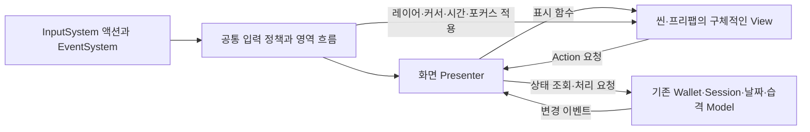

# UI 개편 공통 계약과 수정 경계

## 적용 상태

[전체 설계](../UIRefactorDesign.md)와 [D01~D09](../UIRefactorDifferences.md)를 구현 작업에 연결하는 P0-B 계약이다. 영역별 기능 가족 목록과 [P1-A](P1AImplementation.md)의 레이어·Pause, [확인창·알림](P1BFeedbackImplementation.md), [날짜 전환·D05](P1BDayTransitionImplementation.md), [결과·D07](P1BResultImplementation.md), [대화·D03/D04](P1BDialogueImplementation.md)를 반영했다. 아래 계약의 전체 구현 완료를 뜻하지 않으며 공통 입력·전체 중첩 흐름·영역별 MVP·씬 통합은 남아 있다.

- UI 차이 조사 기준은 `62f7a9a`다. 현재 `feature/bs_patch`의 HEAD는 별도 성능 변경을 담은 `91122f5`이며 그 변경과 UI 스테이징을 보존한다. 브랜치를 전환하거나 미커밋 변경을 덮어쓰지 않는다.
- 관리자는 현재 세션이며 동시 워커 최대8개다. High는 `qoder / DeepSeek-Flash`, 병렬 풀은 `pi / zai / glm-5.3-flash`와 `pi / dgx-spark / qwen3.8-flash-next`를 함께 사용한다. 실제 워커 모델 표시를 확인했으며 Argon 주기는 종료했다.

[메뉴·설정·편집 표시의 P2 적용](P2ParallelWaveImplementation.md)은 기존 브리지 API/참조와 씬 오버라이드를 유지하고 구체 View에 실효 참조를 주입한다. 시작·사운드·이름·레시피·층·시점 및 나가기 확인 정책을 분리했으나 저장 카드·모듈 목록/커스텀·정산·전체 입력/해상도 통합은 남아 있다.
- 기존 파괴 처리·로그 예산 성능 변경과 미커밋 UI 변경이 함께 존재한다. `NightRaidController.cs`의 D07을 수정할 때도 기존 성능 부분을 유지하며 필요한 부분만 편집한다.
- 플레이·테스트·컴파일 실행·검증 입력·캡처는 이번 작업에 포함하지 않는다. 정적 코드·직렬화 참조 대조와 수정 자산의 개별 임포트는 별도다.

## 코드를 읽는 순서

현재 `GameManager.TogglePause()`가 일반 C# `UICancelRouter`에 화면별 취소 판단을 위임하고 `UIManager.Refresh()`는 `PausePresenter`에 일시정지 표시를 위임한다. [ESC·D01](P1ACancelImplementation.md)에서 드래그 취소와 Pause 하위 화면 닫기를 연결했다. 에디터 UI 일부는 LateUpdate에서 Session·Builder를 찾아 표시한다. 개편 후에는 수정하려는 화면의 View/Presenter에서 시작해 필요한 도메인만 따라가도록 만든다.

아래는 구현할 책임 관계다. 박스가 모두 별도 프레임워크나 상속 계층이라는 뜻은 아니다.

- 버튼이 무엇을 하는지: View의 Action → Presenter의 이름 있는 처리 함수 → 기존 도메인 함수 순으로 읽는다.
- 어디에 보이는지: 화면 프리팹 → 루트 View의 직렬화 참조 → UIRoot의 레이어 순으로 읽는다.
- ESC·방향키가 어디로 가는지: 공통 입력 담당 → 현재 영역 흐름 → 최상위 화면 정책 순으로 읽는다.

## 파일 소유권

| 작업 | 코드 소유권 | 프리팹·씬 소유권 | 의존 |
| --- | --- | --- | --- |
| P1-A | `Assets/Scripts/UI/Common`의 흐름·입력·포커스, 기존 GameManager/UIManager의 공통 연결 | 통합 담당자에게 연결 요청 | P0 공통 계약 |
| P1-B | 공통 확인·알림·전환·결과의 View/Presenter | 공통 프리팹은 통합 담당자만 수정 | P1-A 요청 계약 |
| P2-A | `UI/Menu`, `UI/Pause`, `UI/Save`, `UI/Settings`와 대응 기존 UI 코드 | 전용 프리팹만. Intro 씬은 통합 담당자 | P1 |
| P2-B | `UI/WorkshopHud`, `UI/Settlement`, `UI/Orders`와 대응 기존 UI 코드 | 전용 프리팹만 | P1, D05 |
| P2-C | `UI/WeaponEditor` 및 슬롯·이름·코드·레시피·프리셋 UI | 전용 프리팹만 | P1, D01/D02/D06/D09 |
| P2-D | `UI/Customization` 및 도색·색상·스티커·키링 UI | 전용 프리팹만 | P2-C의 편집 대상·입력 점유 계약 |
| P2-E | `UI/Raid` 및 지도·체력·목표·보상·결과 UI | 전용 프리팹만 | P1, D07 |
| P2-F | `UI/Tutorial`, `UI/Ending` 및 대화·안내·은퇴 UI | 전용 프리팹만 | 영역별 튜토리얼 신호, D03/D04/D08 |
| P3-A 통합 담당자 | 씬 초기화·영역 접속부, 필요한 에디터 이관 도구 | `UIManager.prefab`, Intro/Main/습격 씬, 공통 프리팹·오버라이드 | 각 영역 결과 |

기존 코드가 여러 작업에서 필요하면 관리자가 먼저 수정 담당자를 한 명 지정한다. 새 폴더 이름은 이 표를 기준으로 하되 기능 목록에서 합치는 편이 이해하기 쉬운 화면은 중복 생성하지 않는다. 도메인 클래스 전체를 UI 작업자의 소유로 넘기지 않는다.

## MVP와 초기화

1. 씬 초기화 담당자가 Inspector의 Model·View·영역 흐름 참조를 확인한다. UIManager 전체를 새 거대 클래스로 옮기지 않는다.
2. View는 Awake에서 자기 표시와 입력을 숨김·차단 상태로 만든다. 다른 매니저 탐색과 게임 상태 변경은 하지 않는다.
3. Presenter 생성자에 구체적인 View와 필요한 기존 도메인 객체를 전달하고 `Initialize()`로 연결한다.
4. View 이벤트는 `event Action`/`event Action<T>`, 호출은 `?.Invoke()`다. 버튼·포인터·드래그 이벤트는 View 내부에서 연결한다.
5. Presenter는 도메인 요청과 표시 데이터 가공을 맡고 View의 명시적 표시 함수만 호출한다. View는 도메인 객체·다른 화면을 참조하지 않는다.
6. 버튼 구독은 Initialize~Dispose, Model 표시 구독은 화면 열림~닫힘이다. Dispose는 중복 호출에 안전해야 한다.
7. 흐름 담당자는 표시 성공 후 포커스를 적용한다. 필수 참조 누락이면 화면명·필드명 오류를 기록하고 해당 화면만 초기화 실패로 처리한다.

각 화면은 강제 종료·취소·확정의 요청 경로를 분리한다. 숨김 자체로 onNo, 결제, 보상, 저장, 날짜 진행을 호출하지 않는다. 단순 표시 행에 Presenter를 추가하지 않는다.

## 화면 요청과 종료 결과

- 공통 종료 이유는 `Confirmed`, `Cancelled`, `Forced` 세 값으로 구분한다. 도메인 처리 성공/실패와 화면 종료 이유는 별개다.
- 일반 팝업 표시 요청은 성공 여부를 즉시 반환한다. 같은 팝업은 기존 것을 유지하며 중복 요청의 별도 콜백을 등록하지 않는다. 다른 일반 팝업은 거부하며 큐에 넣지 않는다.
- D03 대화→일시정지→이탈 확인과 튜토리얼 Suspend는 명시적으로 허용한 중첩이다. 범용 무제한 스택으로 확장하지 않는다.
- 강제 종료로 사용자 취소 콜백을 실행하지 않는다. 화면 결과를 기다리는 요청에는 Forced 결과를 통지해 대기가 남지 않게 한다.
- 요청자는 대상 ID와 처리 상태를 소유한다. 늦은 응답은 같은 요청·대상이 유효할 때만 적용한다. 실제 성공 후 표시 실패로 도메인 요청을 반복하지 않는다.
- 화면 전환 실패 시 기존 유효 화면과 포커스를 복구한다. 복구 대상이 없으면 해당 흐름에 정의한 복구 경로를 사용한다.

## 레이어와 입력 권한

- `HudLayer → ScreenLayer → PopupLayer → TransitionLayer`. 하위 객체에 새 Canvas를 런타임으로 붙이지 않는다.
- 같은 레이어 내 순서는 흐름 담당자만 바꾼다. D03 중첩은 명시적인 하위/상위 참조로 관리한다.
- 공통 정책은 현재 최상위 입력 대상, 게임 조작 허용, 커서, 시간, ESC 경로를 한 번에 적용한다. GameManager와 개별 UI가 따로 커서·시간을 쓰는 경로를 이관 후 제거한다.
- 영역 흐름은 도메인 상태와 공통 정책을 연결한다. 공통 흐름은 지갑·제작·결과 보상을 계산하지 않는다.
- 기존 액션을 사용하고 별도 키 폴링을 추가하지 않는다. 같은 제스처의 포인터·Submit·F·Space 중복 방지는 현행 가드를 보존한다.
- 일시정지 해제 시 시간을 무조건 1로 덮지 않고 복귀한 하위 흐름의 정책을 다시 적용한다. 정산·지도·튜토리얼 Suspend 등 남아 있는 차단도 함께 복원한다.
- 기존 `Game/Pause`와 `UI/Cancel`을 각각 구독해 한 ESC가 두 번 실행되지 않게 공통 입력 담당자가 진입 경로를 하나로 정한다. 텍스트 입력·Suspend·전환 중에는 우선 소비 여부를 검사한다.
- 현재 ESC 진입은 기존 Game/Pause 한 곳이며 같은 프레임의 중복 요청을 소비한다. 명시적 Resume은 취소 라우팅을 거치지 않는다. Pause 재개는 진입 전 시간 배율을 복원하고 야간이면 0을 유지한다. SetNight 등 나머지 시간 경로의 통합은 후속이다.
- D01의 슬롯 드래그·연속 설치·연속 삭제 취소는 편집 흐름에서 처리 결과를 반환하고, 소비된 ESC가 목록 닫기·작업대 퇴장으로 이어지지 않게 한다.
- D02 슬롯 드래그는 편집·숫자키·회전·팬·줌·층 이동과 충돌하지 않게 입력 점유를 전달한다. 슬롯 드래그와 2D 스트로크의 UI 경계 취소 규칙은 서로 다르게 유지한다.

## 포커스와 레이아웃 수치

- 기존 공용 입력 모듈의 반복 지연 `0.5초`, 반복 간격 `0.1초`를 초기값으로 유지한다. 근거: `Assets/Prefabs/Managers/UIManager.prefab`의 m_MoveRepeatDelay/m_MoveRepeatRate.
- 최초 선택·명시 Navigation 참조는 View에 직렬화한다. Presenter는 데이터 ID에 따른 선택·대체 대상을 결정한다. 끝에서 순환하지 않는다.
- 하위 화면은 입력·Raycast·Navigation 모두 차단하고 선택 객체를 저장한다. 복귀 시 유효한 이전 선택, 없으면 화면 기본/가까운 유효 항목을 선택한다.
- 색상·폰트·연출 시간은 기존 프리팹·코드의 현재 값을 옮긴다. 공통화가 필요한 차이는 대응표에 남기고 일괄 덮어쓰지 않는다.
- CanvasScaler 기준은 1920×1080, ScaleWithScreenSize다. 중앙 주요 콘텐츠의 최초 최대 너비는 기준 너비 1920으로 두고 화면별 기존 여백을 유지한다. 배경과 코너 HUD는 전체 화면 Anchor를 따른다.
- 작업대 콘텐츠의 실제 카메라·포인터 영역은 좌우 UI를 제외한 RectTransform을 명시적으로 전달한다. UI 영역과 카메라 계산에서 다른 숫자를 중복 저장하지 않는다.
- 8단위·간격16·내부여백24는 새 공통 요소의 출발값이며 기존 버튼·텍스트 외형의 임의 재디자인 기준이 아니다.

## 코드 스타일 적용

- 로컬 Visual Studio 17.0·18.0의 CurrentSettings.vssettings에서 CSharp `TabSize=4`, `IndentSize=4`, `InsertTabs=false`를 확인했다.
- 내보낸 설정에서 Ctrl+K,R의 실제 명령 재매핑은 확인되지 않았다. 따라서 특정 명령 실행·사용자 단축키 완전 재현을 완료했다고 주장하지 않는다. 명시한 BSD 중괄호·4칸 공백·여러 줄 블록과 이름 규칙을 적용한다.
- 저장소 `.editorconfig`는 새 `Assets/Scripts/UI/**/*.cs`에만 위 포맷과 이름 규칙을 적용한다. 기존 파일을 옮기기 전까지 일괄 포맷을 실행하지 않는다.
- 클래스·메서드는 PascalCase, 지역 변수는 camelCase, 인자는 `_`, 인스턴스 필드는 `m_`, const/static 필드는 대문자다. Unity 콜백·생성 코드는 예외다.
- 이름 변경 시 Inspector 필드는 `[FormerlySerializedAs]` 또는 같은 작업의 직렬화 이관으로 연결을 보존한다. 이벤트처럼 외부 구독이 있는 API는 호출부까지 같은 소유권 아래 이관한다.
- 스타일 정리는 새 UI 코드와 이번에 실질적으로 이관하는 기존 코드에 한정한다. 파괴 처리·외부 패키지·생성 입력 래퍼 전체를 정렬하지 않는다.

## 테이블 이관 경계

- `RaidMapData`, `CustomerRequestData`, `CustomerOrderData`, `SoundData` 등 기존 TableManager 보관 데이터는 재사용한다. Presenter가 Resources.Load나 별도 캐시를 만들지 않는다.
- 화면별 실제 이관 후보는 영역 기능 목록에서 근거와 함께 제출한다. 모듈·커스텀 카탈로그·튜토리얼 ScriptableObject에 붙은 값을 건드릴 경우 해당 작업 범위를 정해 JSON/직렬화 클래스/TableManager로 옮긴다.
- 문자열 ID는 기존 안정 ID·GUID·씬 이름을 재사용하며 배열 인덱스를 새 ID로 삼지 않는다. UI 순서는 별도 정렬 필드 또는 프리팹 고정 슬롯 배치를 사용한다.
- 레거시 ModuleCatalog의 `moduleId = 목록 위치 + 1`은 이관 시 현재 숫자를 명시적인 ID 필드로 고정한다. 순서를 바꿔 기존 즐겨찾기·해금·저장 데이터가 다른 모듈을 가리키게 만들지 않는다. 공유 코드의 기존 codeId/GUID도 보존한다.
- 레거시 저장소·호출 경로를 남길 경우 AGENTS의 Obsolete/주석/경고 규칙을 적용하고 이관하지 않은 범위·이유를 README에 짧게 남긴다.
- D05의 100 지급, D06의 대출 조건, D07의 지급 확정은 도메인에서 한 번 처리하고 UI 표시용 표에 복사하지 않는다.

### 실제 소스에서 확인한 이관 목록

아래는 이관 대상과 소유권이다. 새 테이블 클래스/API 이름과 자산 참조 해석 방식은 해당 작업에서 확정하며 현재 구현된 것으로 취급하지 않는다.

| 현재 출처 | 이관 내용 | 담당·경계 |
| --- | --- | --- |
| TableManager의 RaidMap/CustomerRequest/CustomerOrder/Sound 등 | 기존 표 조회 재사용 | 각 Presenter가 별도 로더·값 사본을 만들지 않음 |
| ModuleCatalog/ModuleData | 목록 표시·설명·구매/부품 비용 등 이번 편집 기능에서 읽는 정적 값 | P2-C. 현재 숫자 ID와 codeId/GUID 고정, 프리팹·세이브 참조 보존. 도메인 전체 이관이 넘치면 범위와 미이관 경로 명시 |
| PaintMaterialLibrary.CreateDefaults | 재질/색상 옵션·카테고리·기존 생성 파라미터 | P2-D. JSON 데이터와 실제 Material/Texture 생성 로직 분리, 기존 외형 유지 |
| ModulePaletteUI의 ResolveStickerTextures/ResolveKeyringModels | 선택 목록의 안정 ID·표시·정렬·자산 키 | P2-D. Resources.LoadAll의 암묵적 순서를 UI ID로 사용하지 않음 |
| TutorialSequence 및 단계 데이터 | 반복 단계·조건·문구와 실제 씬 대상 참조의 분리 | P2-F. 행 데이터는 직렬화만, 실행/조건은 기존 흐름 로직. 씬 대상은 명시 연결 유지 |
| 반복 확인/안내 문구 | 안정 메시지 ID와 반복 표시 문구 | P1-B 및 영역 담당. 새 언어/번역 기능을 추가하는 작업은 아님 |
| _DayManager의 스킵 지급, RetireUI.Cost 등 UI와 공유하는 진행 비용 | 기존 값의 단일 도메인 출처를 유지하며 조절 데이터 이관 | P2-B/F. D05 이외 지급·비용 수치를 변경하지 않음 |

테이블화와 프리팹화를 혼동하지 않는다. 폰트·레이아웃·UI 참조는 작성된 프리팹에 남기며, 월드 Material/무기 프리팹 등의 자산 참조는 안정 키와 실제 런타임 해석 경로를 함께 이관한다. GUID 문자열만 저장하고 런타임에서 찾을 수 없는 상태로 완료 처리하지 않는다.

## 통합과 완료 조건

- 빌드에 등록된 9개 씬을 필수 통합 대상으로 삼는다: Intro, Main, Tower, WoodenHouse, Millitary_base, JungleCampus, BankGrand, Tutorial_WoodenHouse, JungleCampus_improve. 정확한 경로는 `ProjectSettings/EditorBuildSettings.asset`을 따른다.
- 빌드 미등록 NightRaid_Bank/Airport와 Test 씬도 기능 참조를 분류한다. 미등록·비활성 기능을 자동 활성화하거나 삭제하지 않는다.
- UI 입력의 기준 GUID는 `052faaac586de48259a63d0c4782560b`다. 공용 UIManager 프리팹과 Data/Input 액션 참조는 현재 이 에셋을 참조한다. 각 씬 오버라이드의 실효 참조를 따로 대조해야 한다.
- 구현자는 기능 ID별 기존→새 코드 대응, 실제 프리팹·씬 연결, 삭제할 기존 경로, 수정 파일 목록을 제출한다. 통합 전 새 Presenter만 작성한 상태를 완료로 표시하지 않는다.
- 워커의 완료 보고는 제출 상태다. 관리자 검토에서 실제 경로·API·입력·현재/목표 정책·담당 번호를 대조한 뒤 구현 기준으로 승인한다. 초기 조사 초안에서 실제 오류가 발견됐으므로 초안을 승인된 명세로 취급하지 않는다.
- 수정 Assets 목록을 통합 담당자가 취합하고 각 파일만 AssetDatabase.ImportAsset으로 한 번 임포트한다. 기존 PendingAssetImport 큐에 다른 작업 요청이 있으면 덮어쓰지 않는다. 전체 Refresh 금지.
- 코드 조사·연결 조사·사용자 플레이 확인을 별도로 기록한다. 정적 대조를 플레이 확인으로 표시하지 않는다.
