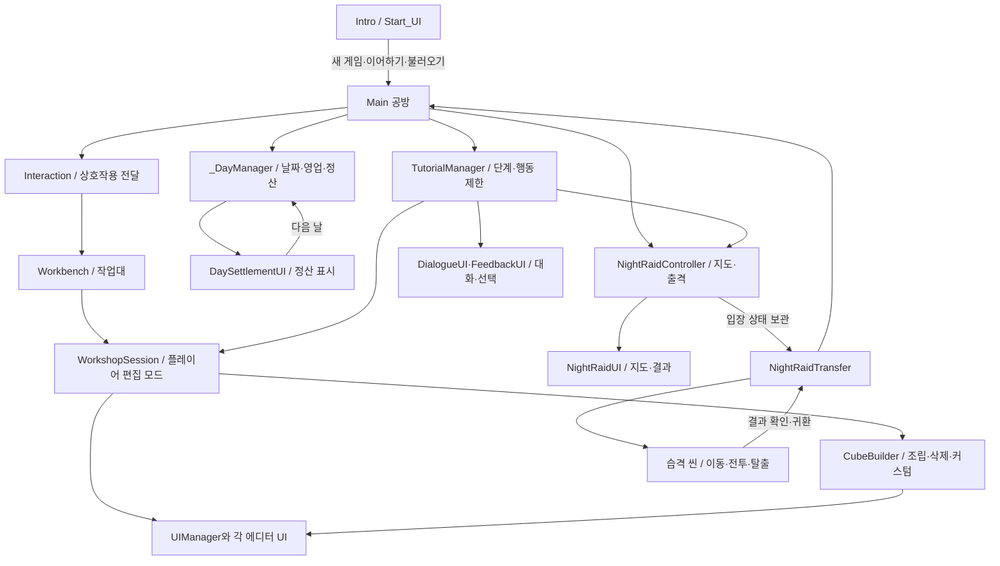

# UI 개편 착수 현황과 현재 구조

## 문서를 읽는 순서

1. 전체 합의는 [UIRefactorDesign](../UIRefactorDesign.md), 최신 동작 변경은 [D01~D09](../UIRefactorDifferences.md)를 본다.
2. 현재 연결의 큰 흐름은 아래 그림을 본다.
3. 화면을 수정할 때는 영역별 기능 목록에서 기능 ID·기존 근거·취소 경로·이관 담당을 찾는다.
4. 새 코드의 역할과 작업 경계는 [Contracts](Contracts.md)를 따른다.

## 현재 메인 흐름

아래는 최초 조사 `62f7a9a` 이후 현재 HEAD `91122f5`와 작업 트리에 반영한 연결 관계다. 전체 목표 MVP 구조의 완성과 구분한다. 실제 플레이 확인은 하지 않았다.

- 시작·불러오기: `Start_UI`가 기존 참조·외부 API를 유지하고 StartMenuPresenter → StartMenuDomainAdapter로 저장 상태와 씬 이동을 연결한다. StartMenuView는 저작된 메뉴 표시·포커스를 담당한다. 저장 카드 자체의 MVP 이관은 후속이다.
- 편집 모드: `WorkshopSession`이 작업대·장착·카메라·입력 맵을 관리한다. `CubeBuilder`와 UI를 한 클래스로 합치지 않는다.
- 화면 제어: `GameManager.TogglePause()`가 일반 C# `UICancelRouter`에 화면별 ESC 판단을 위임하고 `UIManager.Refresh()`는 `PausePresenter`에 일시정지 표시를 위임한다. 드래그 취소·Pause 하위 저장/설정 닫기·직접 Resume을 연결했다. 공통 입력·커서·시간 정책의 전체 이관은 남아 있다.
- 날짜 진행: `_DayManager`가 정산 상태와 다음 날 진행을 소유한다. UI가 날짜·지갑 상태의 두 번째 원본이 되면 안 된다.
- 습격 왕복: `NightRaidController`와 `NightRaidTransfer`가 출발 상태·예정 보상·귀환을 연결한다. 결과창 표시와 실제 지급 시점은 구분한다.
- 튜토리얼: UI 표시뿐 아니라 허용 행동·대상·입력 중복 방지까지 연결된다. 화면만 옮겨 기능을 보존했다고 판단하지 않는다.

## 조사 산출과 현재 상태

| 범위 | 산출물 | 상태 |
| --- | --- | --- |
| ESC·D01 및 Pause 하위 화면 | [P1-A ESC](P1ACancelImplementation.md) | 라우터·드래그 취소·저장/설정 닫기와 포커스 복원·직접 Resume 연결. 전역 입력/시간 소유권은 후속 |
| 슬롯 드래그와 시점 점유·D02 | [P2-C 입력 점유](P2CDragOwnershipImplementation.md) | 기존 드래그 상태를 카메라 입력에서 공유하는 단위. 전체 에디터 MVP·프리팹 이관과 분리 |
| 연속 배치 비용·D06 | [P2-C 비용 안내](P2CStrokeFundsImplementation.md) | 경로 취소 뒤 기존 대출 안내 연결. 구조/부품/달러 실패 구분, 승인 후 자동 설치 금지 |
| 메뉴·설정·편집 표시·D09 | [P2 병렬 이관](P2ParallelWaveImplementation.md) | 시작·사운드·이름·레시피·층·시점 MVP와 View6개 저작, Pause 나가기 Presenter 연결. 층 버튼·배치·방향키 복원. 모듈 목록/커스텀·저장·정산 등 전체 이관은 후속 |
| 남은 화면 이관·해상도 | [P3 화면 이관](P3ScreenMigrationImplementation.md) | 모듈 목록·커스텀·저장·정산·습격·호버·사격장·전투 HUD·튜토리얼 표시·프리셋·매뉴얼·엔딩 MVP와 저작 명령, 씬 인라인 화면 추출, 1920×1080 match 1 환산. 레이어·탐색·입력 정책·월드 상호작용은 진행 중 |
| 공통 구조·계약·스타일 | [Contracts](Contracts.md), 저장소 `.editorconfig` | P1 착수 기준 통합. 전체 화면 API·수정 소유권은 해당 단위에서 구체화 |
| 메뉴·공방 영업 | [MenuWorkshopInventory](MenuWorkshopInventory.md) | 관리자 통합 46개 기능 가족. 상세 연결/플레이 대조 전 |
| 총기 에디터·커스텀 | [EditorCustomInventory](EditorCustomInventory.md) | 관리자 통합 51개 기능 가족. 상세 연결/플레이 대조 전 |
| 습격·튜토리얼·공용 표시 | [RaidTutorialInventory](RaidTutorialInventory.md) | 관리자 통합 46개 기능 가족. 상세 연결/플레이 대조 전 |
| 소스 색인 | [SourceIndex](SourceIndex.md) | 현재 경로와 직접 직렬화 참조·수정 담당. 추출 범위와 한계 명시 |
| 실제 UI 코드·프리팹 개편 | [P1-A 첫 단위](P1AImplementation.md) | 공용 4레이어·Pause View/Presenter·기본 선택·포커스 복원 연결 반영. P1 전체/P2/P3 미완료 |
| 공통 확인창·알림 | [P1-B 첫 단위](P1BFeedbackImplementation.md) | Feedback 브리지·Presenter·확인창/알림 View, 두 프리팹 연결 반영. Forced 종료·Suspend 복귀·기본 선택 분리 |
| 날짜 전환·D05 스킵 | [P1-B 날짜 전환](P1BDayTransitionImplementation.md) | 날짜 전환 MVP·정산/셔터 스킵 호출 통합. 전체 정산은 후속 |
| 습격·파산 결과·D07 | [P1-B 결과](P1BResultImplementation.md) | 결과 View/Presenter·독립 프리팹 연결과 결과 확정 뒤 피해/집계/성공 덮어쓰기 차단. 전체 정산·지도·엔딩 UI는 후속 |
| 대화·D03/D04 보존 | [P1-B 대화](P1BDialogueImplementation.md) | 대화 View/Presenter·저작된 Canvas/차단기/중계 연결. 루트 직계 예외 제거, 안내 대화 중첩·상위 화면 차단·포커스 복귀 반영 |

정적 참조 대조의 보조 범위는 UI 네임스페이스·포인터 인터페이스 패턴의 스크립트 65개와 씬·프리팹 143개다. 이 검색 패턴만으로 모든 기능을 찾았다고 주장하지 않는다. 런타임 생성·partial·유틸리티와 직접 직렬화된 컴포넌트를 따로 분류한다.

워커 초안에 실제 경로/API·현재 입력·합의 정책과 다른 설명이 반복돼 관리자 통합본으로 교체했다. 기능 가족 143개의 등록·담당 배정과 모든 세부 동작/씬 연결의 보존 입증은 별개다. P2/P3는 각 목록의 남은 대조를 기능 ID별로 채워야 한다.

## 보존해야 하는 작업 트리와 한계

- 파괴 처리·공유 프레임 예산·로그 관련 미커밋 변경을 보존한다. `NightRaidController.cs`도 포함되므로 P2-E가 결과 고정 부분을 이관할 때 다른 변경을 덮어쓰지 않는다.
- 현재 브랜치는 `feature/bs_patch`, 이번 구현 착수 시 HEAD는 `91122f5`이며 최초 조사 기준은 `62f7a9a`다. develop 최신화 기록은 이전 작업의 기준이며 현재 브랜치를 develop으로 바꾸지 않는다.
- 공용 UIManager 프리팹의 입력 에셋 참조는 현재 유효한 GUID를 가리킨다. README의 과거 미연결 설명과 다르며 씬별 실효 오버라이드는 별도로 대조한다.
- Visual Studio 설정의 4칸 공백은 확인했지만 Ctrl+K,R의 실제 명령 매핑은 내보낸 설정에서 확인하지 못했다. 새 UI 코드에 명시적인 포맷 규칙을 적용한다.
- 구현·직렬화 연결·사용자 플레이 확인은 각각 따로 기록한다. 문서·계약 작성만으로 UI 개편 완료를 표시하지 않는다.
