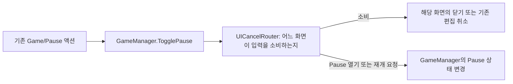

# P1-A ESC 흐름과 D01 연결

화면별 ESC 판단을 GameManager에서 읽기 쉬운 전용 흐름으로 옮기는 단위다. 저장·설정·총기 에디터 전체의 MVP 이관이나 전역 시간·커서·입력 소유권 통합을 완료한 것은 아니다.

## 코드를 읽는 순서

UICancelRouter는 일반 C# 객체다. GameManager는 입력 연결과 Pause 상태·시간·커서 갱신을 유지하고, 화면별 판단을 Router에 위임한다. 새로운 컴포넌트나 범용 화면 등록 시스템·무제한 스택을 만들지 않는다.

기존 InputSystem_Actions의 Game/Pause를 사용한다. UI/Cancel을 추가 구독하거나 새 키 바인딩·직접 키 폴링을 만들지 않는다. 입력 이벤트는 이름 있는 핸들러로 연결하며 같은 프레임의 중복 취소를 한 번만 처리한다. 코드에서 명시적으로 호출한 Resume은 ESC로 해석하지 않는다.

## 이번에 연결하는 정책

| 상황 | 한 번의 ESC 결과 |
| --- | --- |
| 진입 커버·은퇴 표시·튜토리얼 시작 선택·날짜 전환 | 아래 흐름으로 전달하지 않고 소비 |
| 확인창 | 사용자 취소. Suspend 중이면 취소하지 않고 소비 |
| Pause의 저장·설정 화면 | 하위 화면만 닫고 Pause 유지, 유효한 진입 버튼으로 포커스 복귀 |
| 일반 Pause 메뉴 | Pause 닫기 |
| 대화 | 기존 D03에 따라 Pause 열기, 대화는 유지 |
| 슬롯 드래그·2D 연속 배치/삭제 | 해당 드래그만 취소하고 목록·작업대 유지 |
| 드래그가 없는 Tab 목록 | 목록만 닫기 |
| 목록도 없는 작업대 | 기존 퇴장 요청 |

밤의 정산·지도·확정 결과와 상위 차단 화면에서 하위 제작 UI를 닫거나 새 Pause를 여는 경로가 새어 나오지 않게 한다. 레시피·매뉴얼·프리셋·공유 코드·무기 이름·타겟 선택·사격 재시도 등 기존 분기는 삭제하지 않는다. 최종 코드의 명시적 순서가 실제 적용 순서이며 같은 입력에 두 단계가 실행되지 않게 소비 여부를 반환한다.

## D01에서 건드리는 부분

- ModulePaletteUI.TryCancelSlotDrag: 드래그가 없으면 false, 있으면 기존 CancelDrag 후 true.
- CubeBuilder.TryCancelPlanarStroke: 스트로크가 없으면 false, 있으면 기존 CancelStroke 후 true. 배치·삭제를 같은 기존 취소 함수로 정리한다.
- 원래 BeginDrag·Drop·즐겨찾기 변경·드래그 고스트·설치/삭제 확정·결제·Undo 코드는 유지한다. ESC 라우팅을 위해 슬롯 드롭이나 교환을 새로 구현하지 않는다.
- D02의 카메라·숫자키·층 이동 점유 전체 이관은 후속이다.

## Pause 하위 화면과 재개

SaveSlotsUI와 SoundSettingsUI에는 열린 상태와 ESC용 닫기 진입점만 추가한다. 원래 저장/삭제/불러오기 정책과 오디오 즉시 적용·닫기 동작은 유지한다. Intro의 불러오기 화면을 게임 Pause 하위 화면으로 취급하지 않는다.

명시적인 Resume은 하위 화면 닫기 라우팅에 막히지 않고 실제 재개를 요청한다. 재개 시 시간을 무조건1로 만들지 않고 Pause 진입 직전 값을 복원하며, 야간 정지 정책을 우선한다. SetNight·씬 종료와 다른 직접 시간 갱신 경로의 전체 소유권 이관은 후속이다.

정적 소스 대조로 호출 대상과 분기 순서를 확인했다. D01 두 진입점을 제외한 원래 드래그 구현은 작업 시작 소스와 동일하다. 수정 스크립트6개를 AssetDatabase.ImportAsset으로 각각 임포트했다. 테스트·플레이·빌드는 실행하지 않았다. 기존 스테이징과 사용자 변경을 보존하고 실제 커밋은 만들지 않았다.

GameManager가 없는 단독 작업대의 기존 Workshop/Exit 퇴장 경로와 Intro의 ESC는 이번 중앙 라우터 대상이 아니다. Workshop/Exit는 GameManager가 없을 때만 직접 퇴장하므로 일반 게임의 Game/Pause와 중복 퇴장하지 않는다. 엔딩을 포함한 나머지 화면의 전역 입력 소유권은 후속이다.
