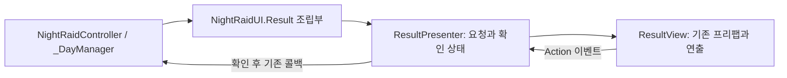

# P1-B 결과 화면 MVP와 D07

날짜 전환 다음 단위로 습격 성공·사망과 파산 결과 화면을 이관한다. 정산 화면 전체·지도 전체·엔딩 선택 UI의 이관 완료를 뜻하지 않는다.

## 읽는 구조

실제 보상·날짜·저장 데이터의 원본은 기존 도메인이다. 결과 화면은 받은 문구를 표시하고, 연출 후 확인 콜백을 한 번 전달한다. 결과창을 숨기거나 비활성화하는 것만으로 귀환·보상·저장을 실행하지 않는다.

## 보존할 흐름

| 경로 | 표시 | 확인 뒤 책임 |
| --- | --- | --- |
| 생존 탈출 | 귀환 성공과 기존 예정 보상 요약 | 기존 ReturnHome에서 복귀 데이터에 보상 반영 |
| 사망 | 사망 제목·이번 습격 재화 미반입 안내 | 기존 사망 복귀 절차 |
| 파산 | 가게를 내놓았다는 기존 제목·안내 | 기존 ReturnAfterBankruptcy에서 Intro 복귀 |

검은 배경 0.45초 → 내용 0.45초 → 확인 가능 → 내용만 0.45초 사라짐 → 기존 콜백 순서다. 실제 시간 기준으로 재생하고, 확인 후 검은 배경을 유지해 씬 귀환 전 공방·전투 화면이 드러나지 않게 한다. 실패 결과는 즉시 탈출 표시를 끄며 성공 결과는 배경이 가려진 뒤 끈다.

원래 `ShowRaidResult(bool, string, Action)`와 `ShowBankruptcyResult(Action)` 진입점은 유지한다. 버튼·기존 UI Submit 경로를 사용하고 새로운 코드 전용 키 바인딩이나 ESC 확인을 추가하지 않는다. 결과 종류의 기존 제목·색상·문구는 유지하며 문구 테이블 전수 이관은 후속 공통 테이블 단위로 남긴다.

## D07 도메인 경계

- 탈출 5초가 끝나는 시점에 이미 사망한 경우 사망을 우선한다. 그 뒤 확정된 성공은 후속 피격·사망 경로로 교체하지 않는다.
- 결과 확정 시 전투·탈출·보상 집계를 종료하고 결과 연출은 실제 시간으로 재생한다. UI 애니메이션 완료가 성공·보상의 확정 시점은 아니다.
- 실제 지급·저장은 기존 확인 후 귀환 처리에 유지한다. UI에서 보상을 더 지급하거나 결과 확정 즉시 저장하지 않는다. 연습·사망·엔딩 포기는 기존 정산 규칙을 유지한다.
- NightRaidController의 기존 파괴 로그·프레임 예산 관련 사용자 변경은 유지하며 D07 관련 분기만 수정한다.

## 프리팹과 작업 경계

실제 원본은 `Assets/Prefabs/UI/NightRaidUI.prefab`이다. 공용 `UIManager.prefab` 안에는 이 프리팹의 중첩 인스턴스가 있다. 원본 루트 `5717281935835683748`과 NightRaidUI 컴포넌트 `6639694460222881928`, 기존 5개 결과 참조 필드와 스크립트 GUID는 유지한다. 씬별 stripped 참조를 새 객체로 교체하지 않는다.

추가 View 컴포넌트는 `7400000000000000001`이며 같은 루트에 작성하고 조립부의 `m_resultView`에 연결한다. 기존 필드 이름은 직렬화 호환 예외로 유지하고 `Configure`로 View에 전달한다. 원본 258개 블록을 보존하고 View 1개만 추가해 259개가 된다. 기존 블록 변경은 루트 컴포넌트 목록과 조립부 참조 추가뿐이다.

결과 화면은 현재 `ScreenLayer` 안에 있다. `SetAsLastSibling`은 해당 부모 안에서만 순서를 바꾸므로 PopupLayer·TransitionLayer 및 기존 별도 Canvas의 전체 정렬 통합을 완료한 것은 아니다. 이번에는 프리팹 계층·Canvas 숫자를 추가 변경하지 않는다. 전체 중첩 화면·ESC·시간 소유권 통합은 P1-A 후속에 남는다.

필수 참조가 없을 때 기존의 즉시 확인 콜백 실행은 제거한다. 설정 오류가 귀환 확정으로 취급되지 않게 로그를 남기고 표시를 거부한다. 공개 void 진입점은 유지하므로 실패를 호출부에 전달하는 공통 요청 결과 계약은 후속이다. 결과 콜백이 씬 이동에 실패할 때 기존 검은 배경 유지 동작도 보존한다.

D07은 기존 `resultOpen`을 종료 상태로 사용하고 `returningAfterDeath`로 확정 결과를 구분한다. 결과 재요청·Update 사망 폴링·ReturnHome 재판정·ReturnAfterDeath의 성공 덮어쓰기를 차단한다. 정확히 등록된 습격 플레이어에 대해서만 결과 뒤 피해·밀림을 막으며 다른 RaidPlayerHealth는 차단하지 않는다. 체력 초기화 시점은 기존 Awake를 유지한다.

기존 결과 수집 가드에 따라 달러·부품·모듈·티켓 집계가 종료되며 연습 모듈 직접 집계와 피격 로그도 종료 상태를 검사한다. 티켓 반영은 확정된 `raidEarnedTickets`를 사용하며, 지급 가능한 비연습 생존 결과에서는 기존 `earnedSlotTickets`와 같은 금액이다. `rewardsCommitted`를 통한 한 번 반영과 기존 저장 형식은 유지한다. 엔딩 포기의 기존 `resultOpen` 경로에 새로운 성공 지급이나 결과 화면을 붙이지 않는다.

정적 소스·직렬화 대조와 수정 자산 7개(스크립트 6개·독립 프리팹 1개)의 개별 임포트를 완료했다. 테스트·플레이·빌드는 실행하지 않았다. 기존 스테이징 22파일의 전체 cached diff는 시작 시점과 동일하며 이번 단위는 별도 미스테이징 상태다. 실제 커밋은 생성하지 않았다.

새 자산은 `UI/Result` 폴더·ResultPresenter·ResultView와 각 메타다. 기존 자산 변경은 NightRaidUI.Result.cs, NightRaidUI.cs의 결과 수명 정리, NightRaidController.cs의 D07 관련 분기, RaidPlayerHealth.cs의 해당 플레이어 종료 상태 검사, NightRaidUI.prefab의 View 연결이다. 공용 UIManager·씬·ReturnOverlay·저장 형식·GameManager는 이번 단위에서 수정하지 않았다.

공개 진입점은 호환을 위한 void API이며 확인 외의 강제 종료를 요청자에게 전달하는 전체 계약 이관은 남는다. 숨김이 사용자 확인으로 간주되지 않는 점은 구현했지만, 기존 요청자가 강제 종료를 받고 도메인 상태를 복구하는 흐름까지 완료한 것은 아니다.
